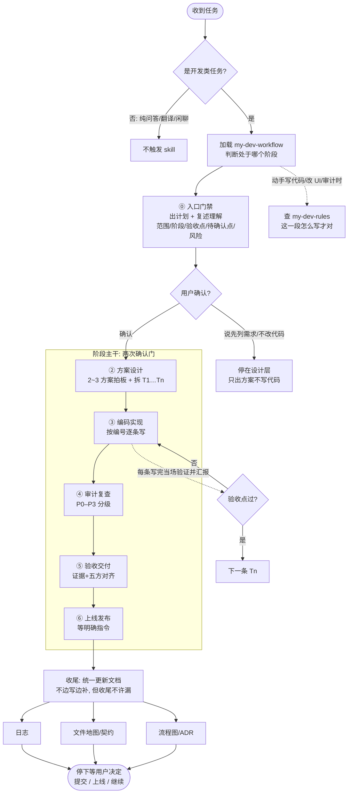
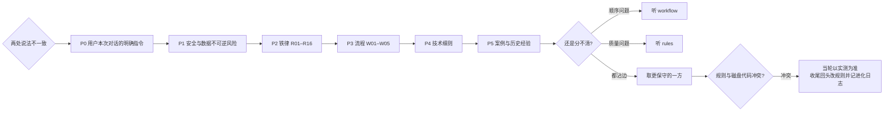
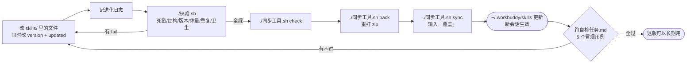

# 我的 Skill 系统 · 工作原理图

这套系统由两个 skill 协作运转。本文用图说明「它是怎么工作的」。

- **my-dev-workflow（workflow v4.1）**：管「整件事怎么推进」——⓪ 入口门禁、②–⑥ 阶段、T1…Tn、问题决策树、日志与文件地图。
- **my-dev-rules（rules v6.1）**：管「这一段怎么做才对」——规则优先级、十六条铁律 R01–R16、案例、4 篇分端技术红线、产品体验、交付规范。

一句话：**工作流决定顺序，规则库决定质量。**

---

## 一、总览：一次开发任务怎么走

**读图要点**

- **确认门只有两道**：⓪ 的计划、② 的方案拍板。原来的「① 需求澄清」已并入 ⓪——复述理解与出计划在同一条消息里，让用户一次点头。
- ②→③ 是主战场：方案必须落成带编号的任务清单，否则③会变成边想边写。
- 收尾才补文档：编码过程中不打断，但收尾时日志 / 地图 / 契约 / 流程图 / ADR 一次补齐。

---

## 二、规则冲突时听谁的

**为什么要这一层**：两套规则并存必然出现口径打架。没有裁决顺序，AI 会挑对自己方便的那条执行——这正是"文档一套、代码一套"的来源。

---

## 三、两个 skill 怎么分工

| 维度 | workflow v4.1 | rules v6.1 |
|---|---|---|
| 回答的问题 | 整件事怎么推进 | 这一段怎么做才对 |
| 核心内容 | ⓪ 门禁、②–⑥ SOP、T1…Tn、决策树、日志、文件地图 | 规则优先级、R01–R16、案例、分端技术红线、产品体验、交付规范 |
| 触发域 | 列计划、排顺序、按编号推进、交接上下文、记日志、整理文件 | 写代码、改 UI、技术方案、审计、排查报错、重构、验收 |
| 加载时机 | 任务一来先加载 | 动手写代码/改 UI/审计时加载 |
| 硬预算 | SKILL.md ≤ 7000 字节 | SKILL.md ≤ 7000 字节 |

**两者不重叠**：frontmatter 的 description 已按上表切成两段，避免一句触发词让两个 skill 各读一遍全文。
真动手写代码时两个都读——先看工作流确认这是③的哪一条 Tn，再查规则库确认这一条具体怎么写。

---

## 四、维护闭环：改完怎么装到系统里

规则**不自动进化**。只有明确要求改规则时才动 skill 文件，然后走这条链：

**方向是单向的**：`My_Skill/skills/` → `~/.workbuddy/skills/`。反过来直接改用户级目录会让本文件夹变成过期快照——2026-11-24 就这么落后过一整个版本（用户级已 5.0/3.0，本文件夹还停在 4.0/1.0）。`check` 就是为拦这个加的。

**为什么加 `校验.sh`**：规则写多了必然出现"说了 A 处、忘改 B 处"。五项检查里最值钱的是**重复段落**和**死链**——它们正是单一事实源被破坏的两个征兆。

**为什么加 `自检任务.md`**：规则写得再漂亮，也可能因为 description 触发词没收好而根本没被加载。5 句话就能验证行为是否符合预期，比读一遍文档可靠。

---

*本图依据当前 skill 内容绘制（workflow v4.1 / rules v6.1）。若主线、门禁或阶段顺序变更，请同步更新本文件，并跑 `./校验.sh` 确认版本一致。*
